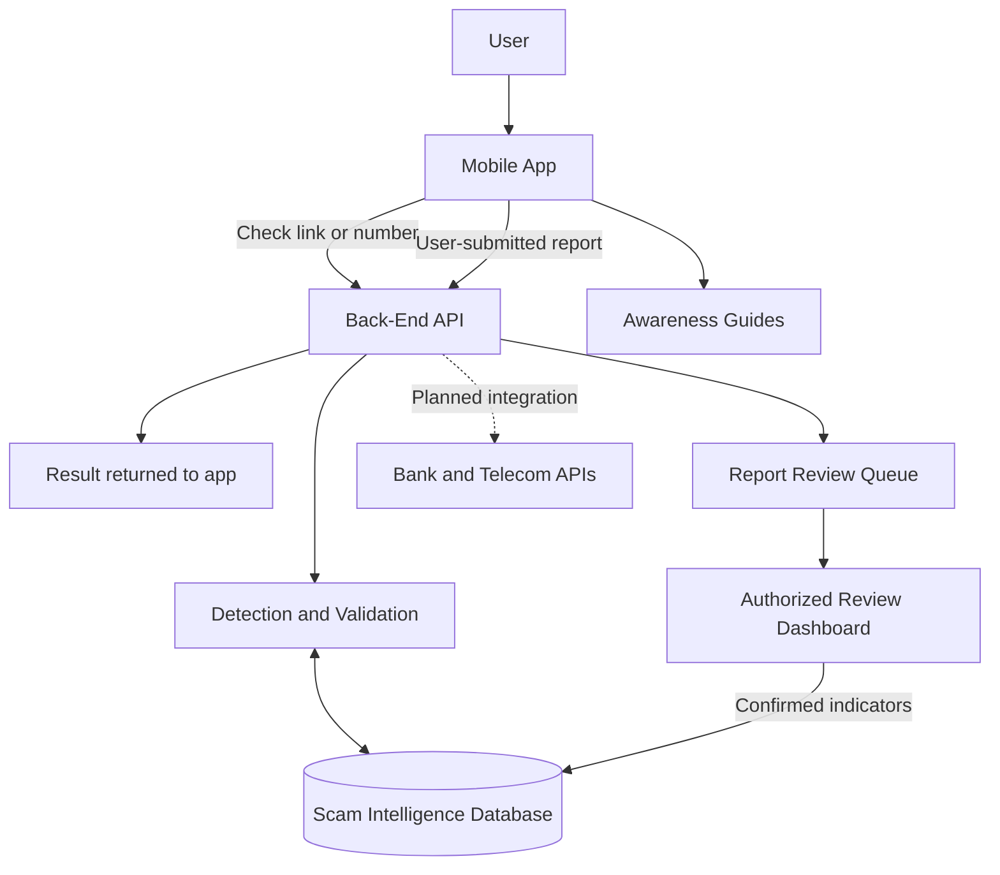

# 🛡️ Scam Shield
### National Anti-Fraud Protection System

  <strong>Helping people recognize digital scams before they become victims.</strong>

  
  
  
  

---

## 📌 Overview

**Scam Shield** is a proposed national anti-fraud protection system designed to help people in Egypt identify suspicious links, phone numbers, SMS messages, and messaging-app scams before interacting with them.

The project aims to turn individual scam reports into shared threat intelligence. When a report is reviewed and confirmed, its relevant indicators can help protect other users from similar scams.

The planned solution combines a mobile application, a back-end service, a shared database of confirmed scam indicators, a review dashboard, and an awareness section.

> **Project status:** This repository describes the project charter and proposed scope. The features below are planned deliverables, not claims that a production system is already available.

## 🎯 Project Objectives

- Reduce financial and personal-data losses caused by phishing and digital fraud.
- Let users check suspicious links and phone numbers and report scams easily.
- Give users clear, understandable results in Arabic and English.
- Build a shared source of reviewed scam indicators.
- Help authorized reviewers identify emerging scam patterns across Egyptian governorates.
- Improve public awareness through short, practical anti-fraud guidance.
- Design for low-end phones and unreliable internet connections.
- Protect user privacy and comply with applicable Egyptian data-protection requirements.

## 🚨 The Problem

People regularly receive messages impersonating banks, e-wallet providers, delivery companies, and other trusted organizations. These messages may pressure recipients to click a link, reveal credentials, or provide sensitive information.

Common challenges include:

- **Fragmented reporting:** People may not know where to report suspicious messages.
- **Limited visibility:** Banks and telecom operators may each see only part of the overall threat landscape.
- **Changing indicators:** Scammers can rotate phone numbers, domains, and message wording.
- **Late detection:** A user may discover the scam only after opening a malicious link or sharing information.
- **Low awareness:** People may struggle to recognize common social-engineering techniques.

Scam Shield proposes a shared reporting and detection workflow to help address these challenges.

## 💡 Proposed Solution

The intended user journey is:

1. **Submit an indicator** — A user enters a suspicious link or phone number, or deliberately shares a message with the app.
2. **Check available intelligence** — The service validates the input and checks available scam indicators and detection signals.
3. **Return a clear result** — The app presents a plain-language status such as *Safe*, *Risky*, or *Confirmed Fraud*, where supported by available evidence.
4. **Submit a report** — The user can report suspected fraud without having to open the suspicious link.
5. **Review the report** — Authorized fraud analysts examine reports before they are treated as confirmed.
6. **Share confirmed indicators** — Reviewed indicators can help inform future checks and integrations.
7. **Learn and stay informed** — Users can consult short awareness guides and examples of common scams.

**Important:** A “Safe” result cannot guarantee that a link is harmless. Newly created or not-yet-reported scams may not appear in available intelligence. Users should never share passwords, one-time passcodes, or banking credentials with an untrusted site.

## 🧩 Planned Deliverables

### 1. Mobile Application

- Android and iOS support.
- Arabic and English interfaces.
- Suspicious-link checking.
- Phone-number lookup.
- One-tap scam reporting.
- Short awareness guides and examples.
- A user-controlled workflow: only messages the user chooses to share or scan are checked.

### 2. Back-End Service and Shared Database

- Service for processing checks and reports.
- Database of confirmed scam links, phone numbers, and patterns.
- API intended for integrations with banks and telecom operators.
- Appropriate access controls and data-handling safeguards.

The charter does not yet specify the API contract, database technology, detection algorithm, or integration protocols; these should be decided during technical design.

### 3. Review Dashboard

- Web dashboard for authorized report reviewers.
- Report-verification workflow.
- Visibility into scam trends by governorate.
- Support for distinguishing unreviewed, rejected, and confirmed reports, subject to detailed requirements.

### 4. Awareness Center

- Short, practical anti-fraud guides.
- Examples of scam messages and common warning signs.
- Guidance intended to help users make safer decisions online.

## 🏗️ High-Level Architecture

The following is a **conceptual view** of the proposed system, not a finalized architecture.

### Main Components

| Component | Responsibility |
|---|---|
| Mobile app | Accept user-initiated checks and reports and display results |
| Back-end API | Receive requests, validate inputs, apply authorization, and coordinate processing |
| Detection and validation | Evaluate available indicators and signals |
| Scam intelligence database | Store relevant scam indicators and their review status |
| Review dashboard | Allow authorized analysts to review reports |
| External integrations | Potentially allow banks and telecom operators to query or share approved intelligence |
| Awareness center | Provide practical educational material |

## 🔍 Detection Results

The charter describes three user-facing result categories:

| Result | Intended meaning |
|---|---|
| **Safe** | No known warning indicators were found in the available checks |
| **Risky** | Suspicious indicators exist, but the evidence is not sufficient to confirm fraud |
| **Confirmed Fraud** | Available evidence supports treating the indicator as fraudulent |

These labels should be accompanied by understandable explanations and carefully designed uncertainty messaging. The detection method and the thresholds for each category remain to be defined.

### Accuracy Considerations

- **False positive:** A legitimate link or message is incorrectly flagged as fraudulent.
- **False negative:** A fraudulent link or message is incorrectly treated as safe.
- **New or changing scams:** A scam may use a new domain, number, or message pattern not yet represented in the database.

Evaluation should measure both detection effectiveness and incorrect warnings. A high number of warnings alone does not mean the system is effective.

## 🗓️ Project Milestones

The dates below are the milestones defined in the project charter.

| Milestone | Target date | Expected outcome |
|---|---:|---|
| Requirements Review | 30 November 2026 | Requirements documented, agreed with the sponsor, and signed off |
| Critical Design Review | 20 December 2026 | Architecture, database design, and app screens approved |
| System Test Review | 31 January 2027 | Functional, performance, and security testing completed, including an independent penetration test |
| Pilot Launch | 15 February 2027 | Limited release to a few thousand real users to assess detection accuracy and identify issues |
| Product Operational | 28 February 2027 | App available on both stores and the review team processing real reports |
| Final delivery deadline | 15 March 2027 | Project delivered within the approved constraints |

## 👥 Planned Project Team

The charter identifies the following staffing plan:

| Role | Headcount | Primary responsibility |
|---|---:|---|
| Android Developers | 2 | Android application development |
| iOS Developers | 2 | iOS application development |
| Back-End Developers | 2 | Server-side services and APIs |
| Security Engineer | 1 | Security design, review, and testing |
| Data / ML Engineer | 1 | Data analysis and detection-engine work |
| UI/UX Designer | 1 | User experience and interface design |
| Fraud Analysts | 2 | Review and verification of scam reports |
| **Total** | **11** | |

### Other Planned Resources

- **Hardware:** 8 laptops.
- **Infrastructure:** Cloud servers hosted inside Egypt.
- **Software and services:** Development tools and IDE licenses, cloud hosting, an SMS/URL reputation data feed, and penetration-testing tools.

## 💰 Budget

**Approved project budget: EGP 1,200,000**

The charter states that the budget covers:

- Salaries.
- First-year hosting.
- Security testing.
- The pilot release.

A detailed cost breakdown has not yet been provided in the charter and should be developed during project planning.

## 🔐 Privacy and Security Principles

Privacy and security are core project constraints, not optional add-ons.

- **User consent:** The app must not read private messages without permission. Only messages the user chooses to share or scan should be checked.
- **Data residency:** User data must be stored on servers inside Egypt, as required by the charter.
- **Legal compliance:** Data must be handled according to the applicable Egyptian Personal Data Protection Law.
- **Access control:** Reviewer and administrative access should be limited to authorized personnel.
- **Data minimization:** Collect and retain only the information necessary for defined project purposes.
- **Secure development:** Validate inputs, protect APIs, manage secrets securely, and test authorization boundaries.
- **Independent testing:** The project plan includes a penetration test by an independent party before the pilot.

These are project principles and planning requirements. The exact controls, retention periods, consent flows, and legal review process must be specified during implementation.

## ⚠️ High-Level Risks

| Risk | Potential impact | Suggested response |
|---|---|---|
| Inaccurate estimates | Delays or budget overruns, especially for detection-engine work | Prototype early and revise estimates using test data |
| Scope creep | The project expands into an antivirus or banking product | Define scope and use formal change control |
| False positives | Users lose trust after legitimate content is flagged | Measure error rates and review disputed results |
| Evolving scam tactics | New campaigns evade existing indicators | Maintain a process for updating intelligence and detection rules |
| Privacy and legal concerns | Exposure of sensitive information or non-compliance | Minimize collected data and review sharing and retention practices |
| Slow partner cooperation | Reduced data coverage and integration reach | Agree on partner responsibilities and interfaces early |
| Loss of key personnel | Delays and loss of specialist knowledge | Document decisions and share knowledge across the team |
| Low user adoption | Limited community benefit despite a working product | Prioritize usability, accessibility, and awareness |
| Unclear success criteria | Teams cannot consistently determine whether a phase is complete | Define measurable acceptance criteria for every milestone |

The responses in this table are proposed mitigations; the charter identifies the risks but does not define a complete risk-treatment plan.

## 📏 Proposed Success Metrics

The charter notes that unclear success criteria are a project risk. The following are **metrics to define during planning**, not approved targets:

- Detection recall and precision on a representative, labeled test set.
- False-positive and false-negative rates.
- Median and 95th-percentile response time for checks.
- Number of reports reviewed and the time required to review them.
- Service availability and successful-request rate.
- Security findings resolved before launch.
- User adoption and continued usage during the pilot.
- Compliance with the approved budget and milestone dates.
- Successful completion of privacy and security acceptance checks.

Numerical targets should be agreed upon before testing and pilot evaluation begins.

## 📦 Scope Boundaries

### In scope

- Mobile app for Android and iOS.
- Arabic and English support.
- User-initiated link and phone-number checks.
- User-submitted scam reports.
- Shared database of confirmed scam indicators.
- Review dashboard.
- Awareness content.
- Planned API integrations with banks and telecom operators.

### Out of scope unless formally approved

- A full antivirus product.
- A banking or payment product.
- Silent or unauthorized monitoring of private messages.
- Any feature that conflicts with the approved privacy, budget, or delivery constraints.

## 🛠️ Technology Stack

The project charter does **not** select specific programming languages, frameworks, database engines, cloud vendors, or machine-learning models.

Those decisions should be made during the Critical Design Review based on security, maintainability, performance, hosting location, cost, and the team's capabilities. Avoid treating any unapproved technology choice as an official project decision.

## 🚀 Development Roadmap

1. Confirm requirements and define acceptance criteria.
2. Design the architecture, data model, API contracts, and app screens.
3. Build the mobile apps, back-end services, database, and review dashboard.
4. Implement and evaluate the detection workflow.
5. Complete functional, performance, privacy, and security testing.
6. Conduct the independent penetration test.
7. Run the limited pilot and analyze detection accuracy and user feedback.
8. Fix priority issues and prepare the operational launch.
9. Launch the product and continue maintaining scam intelligence and awareness content.

This roadmap is a high-level interpretation of the charter's milestones and must be refined into an actionable project plan.

## 🤝 Stakeholders

- **Project sponsor:** Ministry of Communications and Information Technology.
- **Project manager:** Hussein Khalifa.
- **Delivery team:** Mobile, back-end, security, data/ML, UI/UX, and fraud-analysis staff.
- **Potential integration partners:** Banks and telecom operators.
- **End users:** People in Egypt who want to check suspicious messages, links, or phone numbers.

## 📂 Repository Contents

This repository currently documents the project charter and its planned scope.

As implementation progresses, it may include:

- `docs/` — requirements, architecture, and design decisions.
- `mobile/` — mobile application source code.
- `backend/` — back-end services and APIs.
- `dashboard/` — reviewer dashboard.
- `tests/` — automated tests and security test documentation.

These directories describe a suggested repository structure; they should only be added when the corresponding project files exist.

## 🧭 Current Status

**Planning / charter definition**

The charter defines the purpose, planned deliverables, staffing, budget, milestones, constraints, and high-level risks. It does not establish that the system has been implemented, tested, or deployed.

Implementation status, selected technologies, detailed requirements, and measured detection performance should be updated here as they become available.

## ⚖️ Disclaimer

Scam Shield is intended to support scam awareness and risk assessment. It should not be presented as a guarantee that any link, message, or phone number is safe. Detection results depend on available data and the quality of the detection process.

This README reflects the project charter and clearly labels additional technical suggestions as proposals. Legal and regulatory compliance should be reviewed by qualified professionals.

---

  <strong>Scam Shield — Report smarter. Protect more people.</strong>

